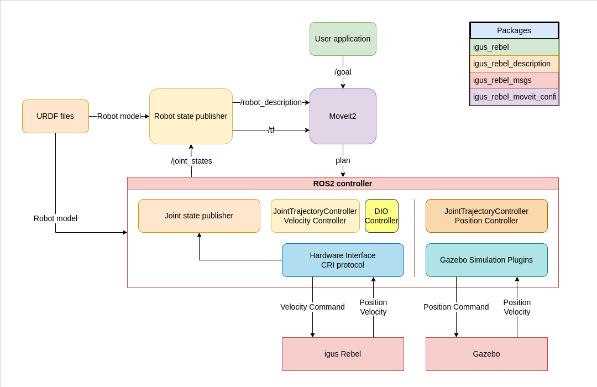

# Overview

The structure of the igus ReBeL control software follows the general ROS2 architecture. The following graph describes how components in the software interact with each other:

The diagram shows only the real-robot and Gazebo backends and predates the XEG-32 gripper, the H-cut executor and the perception packages. There is no separate velocity or DIO controller any more: the real robot uses the joint trajectory controller with a velocity command interface, and digital outputs are a service of the hardware interface (`/set_digital_output`). The description below is current.

The core elements are the planner, using MoveIt 2, and the ros2_control controller manager with the `rebel_arm_trajectory_controller` (joint trajectory controller) and the joint state broadcaster. The hardware backend is selected with the `hardware_protocol` launch argument (default `rebel`; always pass it explicitly):

- `rebel` — the real igus ReBeL through the `Igus::Rebel` CRI hardware interface (velocity command interface, `config/controller.yaml`).
- `mock_hardware` — `mock_components/GenericSystem`, which echoes position commands back as state without any robot (`config/controller_mock.yaml`). Used for isolated planning and execution tests.
- `gazebo` — a Gazebo simulation through `gz_ros2_control` (`igus_rebel_simulated.launch.py`).
- `isaac_topic` — `topic_based_ros2_control` bridging to Isaac Sim over `/isaac_joint_commands` and `/isaac_joint_states` (`rebel.launch.py` only).

The package *igus_rebel* contains the CRI hardware interface for the real robot, the controller configurations and `rebel.launch.py` (robot_state_publisher plus controllers for every backend). The package *igus_rebel_moveit_config* contains the MoveIt 2 configuration, the MoveIt launch files, the Gazebo launch, and the application nodes (H-cut executor, calibration verification, Servo teleoperation).

The robot model is stored in the package *igus_rebel_description*. `igus_rebel_xeg32_wrapper.urdf.xacro` is the model used by every backend: it adds the XEG-32 gripper and the `igus_tool0 -> xeg32_tool_tip` TCP to the arm and declares the ros2_control hardware plugin for the selected backend (and the Gazebo plugin for `gazebo`).
