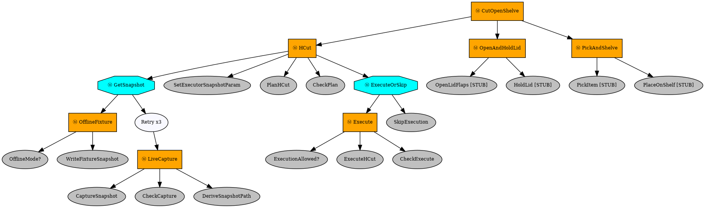
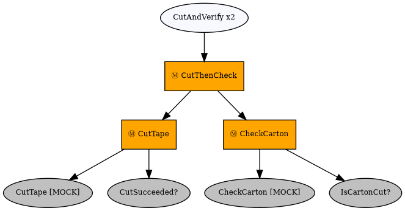

# 雙臂任務行為樹（py_trees_ros）— 第一步

完整任務流程：**H-cut 切箱 → 掀開並固定上蓋 → 取物上架**。這是能實際跑起來的最小版本：

- **H-cut**：呼叫真的 ROS service（`box_perception`、`box_h_cut_executor`）。
- **掀蓋、取物上架**：還沒有實作，先用 `[STUB]` 佔位節點代替。它們只會模擬成功，**不會動任何東西**。



## 怎麼跑

```bash
# Terminal 1：雙臂 stack（mock，不接真實手臂）
ros2 launch igus_rebel_moveit_config dual_arm_rig_isaac.launch.py \
    hardware_protocol:=mock_hardware use_sim_time:=false

# Terminal 2：跑行為樹
python3 scripts/task_tree/run_task_tree.py --offline-snapshot   # 沒有相機時：用 USD 紙箱產生的假快照
python3 scripts/task_tree/run_task_tree.py                      # 有相機時（Isaac Sim）：真的拍快照

# Terminal 3（選用）：即時看每個節點的狀態
py-trees-tree-watcher

# 不需要 ROS：只重畫樹狀圖
python3 scripts/task_tree/run_task_tree.py --render
```

跑完會印出整棵樹最後的狀態，以及摘要（快照檔、規劃訊息等）。成功時 exit code 為 0，失敗為 1。

**安全**：預設**只規劃、不執行**。要執行必須同時加 `--execute --i-understand-this-moves-the-real-robot`，只加一個會直接報錯。即使兩個都加，`box_h_cut_executor` 自己的 `execution_enabled` 參數也要為 true 才會真的動；這個參數行為樹不會去改。

## 行為樹 5 分鐘入門（用這棵樹當例子）

行為樹由上往下、由左往右「**tick**」（詢問）每個節點。每個節點回答三種狀態之一：

| 狀態 | 意思 | 例子 |
|---|---|---|
| **SUCCESS** ✓ | 做完了，成功 | 快照寫好了 |
| **FAILURE** ✕ | 做完了，失敗 | 規劃找不到解 |
| **RUNNING** * | 還在做，下次 tick 再問我 | MoveIt 正在規劃（要好幾秒） |

`RUNNING` 是行為樹跟一般程式最大的不同：樹不會卡在某個步驟，每 0.5 秒 tick 一次，長時間的工作就一直回報 RUNNING，直到做完。

### 組合節點（決定「怎麼做」）

- **Sequence `{-}`**：**依序**做每個子節點，**一個失敗就整個失敗**。像是「然後…然後…」。
  - 例：`CutOpenShelve` = 切箱 → 掀蓋 → 上架。切箱失敗就不會去掀蓋。
- **Selector `{o}`**（也叫 Fallback）：**依序試**每個子節點，**第一個成功就停**。像是「先試 A，不行就試 B」。
  - 例：`GetSnapshot` = 離線快照（只有加 `--offline-snapshot` 才會成功）→ 不行就改用相機拍。
  - 例：`ExecuteOrSkip` = 允許執行就執行 → 否則記錄「只規劃」，然後算成功。

### 葉節點（真正「做事」或「檢查」）

- **動作**：呼叫 service，例如 `CaptureSnapshot`、`PlanHCut`。
- **條件**：只檢查、不做事，例如 `OfflineMode?`、`ExecutionAllowed?`。名稱結尾的 `?` 是命名慣例。
- **檢查結果**：例如 `CheckPlan`。py_trees_ros 的 service 節點只要「有收到回應」就回報 SUCCESS，不管伺服器回應的 `success` 是 true 還是 false，所以每次呼叫後面都接一個檢查節點。

### Decorator（包住一個節點、改變它的行為）

- **`Retry x3` `-^-`**：子節點失敗就重來，最多 3 次。例：相機這次沒拍到，就再拍一次。

### Blackboard（節點之間傳資料的共用白板）

節點之間不直接傳參數，而是寫到 blackboard、再從 blackboard 讀。例：
`WriteFixtureSnapshot` 或 `DeriveSnapshotPath` 寫入 `snapshot_file` → `SetExecutorSnapshotParam` 讀出來，設給 executor。

## 檔案

| 檔案 | 內容 |
|---|---|
| `run_task_tree.py` | 組樹（`build_tree()` / `build_h_cut()`）、參數、執行、印摘要 |
| `behaviours.py` | 自訂的葉節點：`CheckResponseSuccess`、`DeriveSnapshotPath`、`WriteFixtureSnapshot`、`SetRemoteParameter`、`LogAndSucceed`、`NotImplementedStub` |
| `dual_arm_task_tree.png` | `--render` 產生的樹狀圖 |

只呼叫 service、不需要額外邏輯的節點，直接使用 `py_trees_ros.service_clients.FromConstant`，沒有另外寫類別。

## 目前狀態（2026-09-25，mock_hardware 實測）

- ✅ 行為樹機制都驗證過：離線快照寫出 → executor 的 `external_snapshot_file` 被自動設好，取代原本手動的 `ros2 param set` → `PlanHCut` 規劃中顯示 RUNNING → 結果回傳。沒有相機時，`CaptureSnapshot` 重試 3 次後整棵樹回報 FAILURE，並附上原因（「No synchronized RGB-D frame is available」）。只加 `--execute` 會直接報錯。
- ⚠️ **用離線快照時，H-cut 規劃本身會失敗**：MTC 在 `align above middle seam start`（ompl_cartesian）這個 stage 找不到解，前一個 stage `transit above …` 是成功的。這是 H-cut 規劃器對 USD 紙箱位置（中心 (0, −0.6)、頂面 z≈0.98）的可達性或姿態問題，跟行為樹無關。`dual_arm_box_h_cut_executor.yaml` 裡的校正數字本來就是從單臂照抄的，這是下一個要處理的問題。
- 規劃成功之後的流程（SkipExecution → 兩個 STUB 階段 → 整棵樹 SUCCESS）只在「把規劃節點換成直接成功」的離線測試中驗證過，還沒在真正規劃成功的情況下跑過。

## 下一步：把 STUB 換成真的

1. 先在 ROS 端做出那個步驟，最好做成 **action**：可以回報進度、可以取消。例如 `OpenLid.action`。
2. 在 `build_tree()` 裡把 `NotImplementedStub("OpenLidFlaps")` 換成 `py_trees_ros.action_clients.FromConstant(...)`，或換成 service 版本，後面接一個檢查節點。
3. 需要前一步的資料（例如紙箱位置）時，從 blackboard 讀取。

其他待辦：接 Isaac Sim 相機走 LiveCapture 的真實路徑；評估是否改用已經設計好、但還沒實作的 `igus_rebel_msgs/action/CutBox.action` 當 H-cut 的上層入口。

---

# 切割＋檢查行為樹（`cut_and_check_tree.py`，目前是 mock）

兩個子動作：**切割膠帶** → **檢查紙箱是否已切開**，最後只會得到 SUCCESS 或 FAILURE 其中一種。檢查失敗時會整組「切 → 檢查」重來，最多重做 `--max-attempts` 次。



```
-^- CutAndVerify xN            Retry：失敗就重來，最多 N 次
    {-} CutThenCheck
        {-} CutTape
            --> CutTape [MOCK]      動作葉節點 → blackboard.cut_result
            --> CutSucceeded?       讀 cut_result.success
        {-} CheckCarton
            --> CheckCarton [MOCK]  動作葉節點 → blackboard.check_result
            --> IsCartonCut?        讀 check_result.success → blackboard.is_tape_cut
```

兩個子動作現在都是 `MockActionLeaf`：會先回報幾個 tick 的 RUNNING，再寫入一個假的 result。**不會動任何東西，也不需要開其他 ROS node。**

```bash
python3 scripts/task_tree/cut_and_check_tree.py                       # SUCCESS，exit 0
python3 scripts/task_tree/cut_and_check_tree.py --mock-check-fail 1   # 第 1 次檢查失敗 → 重切 → SUCCESS
python3 scripts/task_tree/cut_and_check_tree.py --mock-check-fail 5   # 重試次數用完 → FAILURE，exit 1
python3 scripts/task_tree/cut_and_check_tree.py --mock-cut-fail 1 --max-attempts 1   # 切割就失敗、不重試
python3 scripts/task_tree/cut_and_check_tree.py --render              # 只重畫樹狀圖
```

結果：exit code（0 = 成功、1 = 失敗）＋ blackboard 的 `is_tape_cut`（True / False）。

## 為什麼每個子動作都是「動作葉節點＋檢查節點」

py_trees_ros 的 action client 只要 goal 是 SUCCEEDED 就回報 SUCCESS，**不會看 result 裡面的 `success`**。像 CutBox 如果 IK 解不出來，回傳的是「正常結束、但 `success=false`、`error_code=IK_FAILED`」，這時 action client 一樣會回報 SUCCESS。所以約定如下：

- 動作葉節點只負責「把 result 放上 blackboard」，有結果就回報 SUCCESS。
- 後面接的 `CheckResponseSuccess` 再依 `result.success` 判斷 SUCCESS 或 FAILURE。

mock（`MockActionLeaf`）和真實版（`ActionResultToBlackboard`）寫進 blackboard 的資料格式相同，都有 `.success` 和 `.message`，所以兩者可以直接互換。

## 換成真的 action server

只需要改 `make_cut_tape()` / `make_check_carton()` 裡回傳的那一個葉節點，樹的結構、blackboard key、檢查節點都不用動：

1. **切割**：使用 `igus_rebel_msgs/action/CutBox.action`（已經設計好，但**還沒寫進 `igus_rebel_msgs` 的 CMakeLists、還沒編譯，也還沒有 server**）。
   ```python
   allowed = args.execute and args.i_understand
   goal = CutBox.Goal(execute=allowed, i_understand_this_moves_the_real_robot=allowed)
   return ActionResultToBlackboard("CutTape", CutBox, "/cut_box", goal, "cut_result")
   ```
   安全旗標要靠 goal 裡的兩個 bool，沒設定就是不會動。CLI 端維持雙重確認，只給一個旗標會直接報錯。
2. **檢查**：目前還沒有 action 定義，需要新增一個，例如 `CheckCartonCut.action`，result 至少要有 `bool success` 和 `string message`。判斷方法可以參考 `scripts/verify_tape_cut_behavior.py` 的深度階差法。
3. 在 `main()` 裡，`tick_tock` 之前先等 action server 上線，等不到就直接報錯。做法比照 `run_task_tree.py` 的 `wait_for_services()`。

`ActionResultToBlackboard` 已經用 `example_interfaces/Fibonacci` 和一個假的 server 跑過完整來回，確認真實的 Result 會寫進 blackboard；還沒有接 CutBox 測試過。

---

# H-cut 切箱行為樹（真實版介面，`h_cut/`）

上面的 `cut_and_check_tree.py` 的下一步：**H-cut action ＋ 真的膠帶檢查（`cut_check_code`）**，可以交付給負責 H-cut action server 的人整合。完整的使用與整合指南見 [`h_cut/README.md`](h_cut/README.md)。

- 介面：`src/compal_cut_task_msgs`（`HCut.action`、`CheckCut.action`）。
- 要接上別人的 H-cut server，只需要改 `h_cut/h_cut_interface.py`。
- 只有在檢查結果是 `NOT_FULLY_CUT` 時才會重切；H-cut 失敗或檢查結果是 `NOT_CHECKED` 時，直接 FAILURE。
- 目前只用 mock server 和合成影片驗證過流程。
