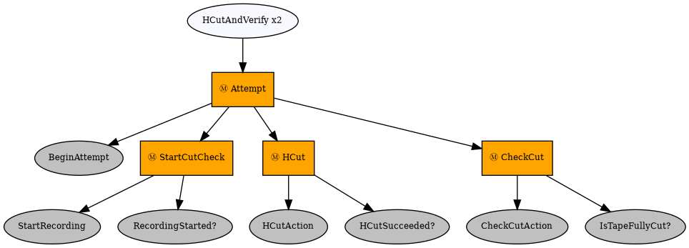

# H-cut 切箱行為樹：使用與整合指南

這份文件寫給**負責 H-cut 切箱 action server 的人**。看完後你可以做到：

1. 不接手臂、不開 MoveIt，先用 mock 把整棵樹跑一次，看懂它在做什麼（約 10 分鐘）。
2. 把你寫好的 H-cut action server 接進行為樹：**只需要改一個檔案** `h_cut_interface.py`，或是讓你的 server 直接實作 `HCut.action`。
3. 實際跑一次，看最後的判斷：**膠帶有沒有完全切開？可以進入下一階段（掀蓋）嗎？**

> ⚠️ 安全：這棵樹預設**只規劃、不動手臂**。要讓手臂動，必須**同時**加上 `--execute --i-understand-this-moves-the-real-robot`，只加其中一個會直接報錯。整套程式目前只用 mock 驗證過，從未接過真實手臂。第一次接真實硬體之前，請先跟專案負責人確認。

---

## 1. 這棵樹在做什麼



```
-^- HCutAndVerify xN        只有在檢查結果是 NOT_FULLY_CUT 時才重切，最多 N 次
    {-} Attempt
        --> BeginAttempt      attempt += 1；上一輪的檢查報告 → 這一輪的 re-cut hint
        {-} StartCutCheck     /cut_check/start：開始錄兩支手腕相機
        {-} HCut              ← 你的 H-cut action server（透過 h_cut_interface.py）
        {-} CheckCut          /cut_check/check_cut：停止錄影，判斷膠帶是否完全切開
                              → blackboard.is_tape_cut
```

一次 attempt 的時間軸：

```
StartCutCheck       HCut（你的 server，手臂在切）            CheckCut
     │  開始錄影  ───────────── 錄 wrist / right_wrist ───────────►│ 停止錄影 → 分析 → 判斷
```

**膠帶檢查**用的是 `../cut_check_code/cut_check/`（`check_run.py` → 每支手臂各跑一次 `analyze_video.py`）。它從手腕相機影片中找出刀子在箱子上的每一段切割（top seam／邊緣），判斷每段是「切開（綠）」還是「沒切開（紅）」。

### 最後的結果只有三種情況

| 檢查結果 `verdict` | 意思 | 行為樹接下來做什麼 |
|---|---|---|
| `FULLY_CUT` | 每一段都切開了 | **SUCCESS**，exit code 0，`is_tape_cut=True`，可以進下一階段 |
| `NOT_FULLY_CUT` | 有某些段要重切（`recut` 會列出是哪一段、從幾 % 到幾 %） | 重切：再送一次 H-cut goal（`attempt=2`，附上 `recut_hint_json`），切完再檢查。用完 `--max-attempts` 次仍沒切開就 FAILURE |
| `NOT_CHECKED` | 無法判斷（沒錄到影像、影片裡找不到切割動作、分析出錯） | **直接 FAILURE、不重切**，重切也解決不了這類問題 |

另外，**H-cut 本身失敗**（感知失敗、IK 無解、執行錯誤……）也會**直接 FAILURE、不重切**。執行出錯之後自動再動一次手臂太危險，要由人來判斷。

---

## 2. 交付內容

| 路徑 | 內容 | 你需要改嗎？ |
|---|---|---|
| `src/compal_cut_task_msgs/` | ROS 2 介面套件：`HCut.action`、`CheckCut.action` | 不用，複製到你的 workspace 一起 build 就好 |
| `scripts/task_tree/h_cut/h_cut_tree.py` | 行為樹本體（主程式） | 不用 |
| `scripts/task_tree/h_cut/h_cut_interface.py` | **H-cut action 的轉接層：型別、名稱、goal 怎麼填、result 怎麼解讀** | **要改：這是唯一要改的檔案**（若選方式 A，最多只改 action 名稱） |
| `scripts/task_tree/h_cut/h_cut_behaviours.py` | 這棵樹專用的節點：`ActionLeaf`、`BeginAttempt`、`RetryWhenNotFullyCut` | 不用 |
| `scripts/task_tree/h_cut/cut_check_server.py` | 膠帶檢查的 ROS 2 節點（包裝 `cut_check_code`） | 不用，改參數就好（相機 topic） |
| `scripts/task_tree/h_cut/mock_h_cut_server.py` | 假的 H-cut server，**不會動任何東西**，也是 HCut server 的最小範例 | 不用 |
| `scripts/task_tree/behaviours.py` | 共用節點（`CheckResponseSuccess`） | 不用 |
| `scripts/task_tree/cut_check_code/cut_check/` | 膠帶切割辨識（影像演算法） | 不用 |

請把整個 `scripts/task_tree/` 資料夾連同 `src/compal_cut_task_msgs/` 一起交付，不要只拿 `h_cut/`。`h_cut/` 會用到上層的 `behaviours.py` 和 `cut_check_code/`。

---

## 3. 環境準備（一次就好）

```bash
# ROS 2 Jazzy + 行為樹套件
sudo apt install ros-jazzy-py-trees-ros ros-jazzy-cv-bridge
# 影像分析（cut_check）
pip install "opencv-python>=4.5" "numpy>=1.21"      # 系統若已有 python3-opencv 可略過

# 編譯介面套件（放在 workspace 的 src/ 底下）
cd ~/compal_robot                 # 換成你的 workspace
colcon build --packages-select compal_cut_task_msgs
source install/setup.bash

# 確認
ros2 interface show compal_cut_task_msgs/action/HCut
```

**之後每開一個新的 terminal，都要先 `source install/setup.bash`。**

---

## 4. 第一步：用 mock 把整棵樹跑一次（不需要手臂、相機、MoveIt）

開三個 terminal（都要先 `source install/setup.bash`）：

```bash
# Terminal 1：假的 H-cut server（不會動任何東西，3 秒後回報成功）
python3 scripts/task_tree/h_cut/mock_h_cut_server.py

# Terminal 2：膠帶檢查，mock 模式：第 1 次回答「沒切開」，第 2 次回答「切開了」
python3 scripts/task_tree/h_cut/cut_check_server.py --ros-args -p mock_verdicts:=NOT_FULLY_CUT,FULLY_CUT

# Terminal 3：行為樹
python3 scripts/task_tree/h_cut/h_cut_tree.py
```

預期結果（第 1 次檢查沒過 → 帶著 re-cut hint 重切 → 第 2 次檢查通過）：

```
  attempts         2
  h_cut_message    [MOCK] H-cut done (plan only) (3.0 s) (did_move=False)
  check_message    FULLY_CUT: [MOCK] check 2
  is_tape_cut      True
  => H-cut task SUCCESS  (tape fully cut, OK to open the lid)
```

Terminal 1 會看到 `attempt 2 with re-cut hint: plan only`，代表第二次的 goal 有帶上一輪的檢查報告。

換參數，可以把每種情況都看過一次（每換一次都要重開 Terminal 1／2）：

| 想看的情況 | Terminal 1 | Terminal 2 `mock_verdicts:=` | Terminal 3 | 結果 |
|---|---|---|---|---|
| 一次就切開 | 預設 | `FULLY_CUT` | 預設 | SUCCESS，attempts 1 |
| 重切後成功 | 預設 | `NOT_FULLY_CUT,FULLY_CUT` | 預設 | SUCCESS，attempts 2 |
| 一直切不開 | 預設 | `NOT_FULLY_CUT` | `--max-attempts 3` | FAILURE，attempts 3 |
| 無法判斷 | 預設 | `NOT_CHECKED` | 預設 | FAILURE，不重切 |
| H-cut 失敗 | `--ros-args -p fail_attempts:=1` | `FULLY_CUT` | 預設 | FAILURE，不重切、也不檢查 |

另外可以試試：H-cut 執行到一半時，在 Terminal 3 按 **Ctrl-C**，Terminal 1 會印出 `cancelled by the client`。中斷行為樹時，正在執行的 H-cut goal 一定會被取消。**你的 server 也要正確處理 cancel**，見 5.1。

想即時看每個節點的狀態：另開一個 terminal 跑 `py-trees-tree-watcher`。

---

## 5. 把你的 H-cut action server 接進來

### 5.1 你的 server 必須遵守的約定

不管選 A 還是 B，下面五點都要做到：

1. **「預期內的失敗」要正常結束，並回傳 `success=false`**：例如感知失敗、IK 無解、規劃失敗，請用 `goal_handle.succeed()` 結束，在 result 裡填 `success=false` 和原因。`abort()` 只留給程式崩潰這種意外狀況。行為樹兩種都當作失敗處理，但前者的 `message` 會完整顯示在摘要裡，除錯容易得多。
2. **安全旗標：沒收到「可以動」，就絕對不能動。** 預設（欄位全部是 0／false）必須是「只規劃、不動」。不要用 `dry_run=true` 這種「預設值才安全」的設計：C++ 端忘記設欄位時是 false，手臂就會直接動。
3. **支援 cancel**：收到 cancel 要盡快讓手臂停下來，回傳 `canceled()`。行為樹被 Ctrl-C 或被上層中斷時，就是靠 cancel 停下手臂。
4. **一次只接一個 goal**：正在切的時候又收到 goal，請 reject 或回傳 `BUSY`。
5. **切割過程中，手腕相機要持續發布影像**（或是由你的 server 自己錄影，再把資料夾路徑回傳給樹，見第 6 節）。

### 5.2 方式 A（推薦）：讓你的 server 實作 `HCut.action`

`h_cut_interface.py` 完全不用改（如果 action 名稱不是 `/h_cut`，改 `ACTION_NAME` 就好）。

介面（完整註解見 `src/compal_cut_task_msgs/action/HCut.action`）：

| 欄位 | 方向 | 說明 |
|---|---|---|
| `execute`、`i_understand_this_moves_the_real_robot` | Goal | **兩個都是 true 才可以動手臂**；否則只規劃 |
| `attempt` | Goal | 1 = 第一次切；2、3… = 檢查沒過之後的重切 |
| `recut_hint_json` | Goal | 第一次是空字串；重切時是上一輪的檢查報告（哪一支手臂、哪一段、幾 % 到幾 %）。做不到只補切局部的話，可以忽略它、整個 H 重切 |
| `timeout_sec` | Goal | ≤ 0 = 用你自己的預設值 |
| `success`、`error_code`、`message` | Result | 見 5.1 第 1 點；`message` 寫一行就好，會印在摘要裡 |
| `did_move` | Result | 這次手臂有沒有真的動 |
| `run_folder` | Result | 選填：如果是你自己錄手腕相機，就回傳資料夾路徑（見第 6 節） |
| `stage`、`progress`、`message` | Feedback | 選填：顯示在 tree watcher 上 |

Python server 骨架（完整可執行的範例請看 `mock_h_cut_server.py`）：

```python
from compal_cut_task_msgs.action import HCut
from rclpy.action import ActionServer, CancelResponse

class MyHCutServer(Node):
    def __init__(self):
        super().__init__("my_h_cut_server")
        ActionServer(self, HCut, "/h_cut", execute_callback=self.execute,
                     cancel_callback=lambda _: CancelResponse.ACCEPT)

    def execute(self, goal_handle):
        g = goal_handle.request
        allowed = g.execute and g.i_understand_this_moves_the_real_robot   # 兩個都要 true
        result = HCut.Result(did_move=False)
        ok, why = self.plan_h_cut()                     # ← 你原本的規劃
        if not ok:
            result.success, result.error_code, result.message = False, HCut.Result.PLANNING_FAILED, why
            goal_handle.succeed(); return result        # 預期內的失敗：succeed + success=false
        if allowed:
            ok, why = self.execute_h_cut(goal_handle)   # ← 你原本的執行；過程中要檢查 goal_handle.is_cancel_requested
            result.did_move = True
        result.success, result.message = ok, why
        result.error_code = HCut.Result.OK if ok else HCut.Result.EXECUTION_FAILED
        goal_handle.succeed(); return result
```

C++ server：`#include "compal_cut_task_msgs/action/h_cut.hpp"`，型別是 `compal_cut_task_msgs::action::HCut`；在 `package.xml` 和 `CMakeLists.txt` 加上 `compal_cut_task_msgs` 依賴就好，其餘寫法跟一般的 `rclcpp_action` server 一樣。

### 5.3 方式 B：沿用你自己的 action 型別

改 `h_cut_interface.py` 就好，行為樹的其他部分都不用動。假設你的 action 是：

```
# my_cut_msgs/action/BoxHCut.action
bool allow_motion
string mode            # "plan" / "plan_and_execute"
---
bool ok
string error_text
---
float32 percent
```

那 `h_cut_interface.py` 改成：

```python
from my_cut_msgs.action import BoxHCut as ACTION_TYPE        # ① 你的型別

ACTION_NAME = "/box_h_cut"                                    # ② 你的 action 名稱（ros2 action list）


def make_goal(ctx):                                           # ③ 把行為樹的資訊對應到你的 goal
    goal = ACTION_TYPE.Goal()
    goal.allow_motion = ctx.execute_allowed                   #    ⚠️ 只能從 ctx.execute_allowed 來
    goal.mode = "plan_and_execute" if ctx.execute_allowed else "plan"
    # ctx.attempt / ctx.recut_hint_json：你的 goal 沒有對應欄位的話，不用理它們
    return goal


def interpret_result(result):                                 # ④ 你的 result → (成功?, 一行訊息)
    return result.ok, result.error_text or "ok"


def run_folder_from_result(result):                           # ⑤ 沒有自己錄影就回傳 ""
    return ""


def feedback_text(feedback):                                  # ⑥ 選填
    return f"{feedback.percent:.0f}%"
```

⚠️ **最重要的是第 ③ 點**：讓手臂動的條件只能來自 `ctx.execute_allowed`。它只有在使用者同時下了 `--execute --i-understand-this-moves-the-real-robot` 時才會是 True。**不要把它寫死成 True。** 如果你的 action 只有 `dry_run` 這類欄位，要寫成 `goal.dry_run = not ctx.execute_allowed`，並且再確認一次：你的 server 收到預設 goal 時不會動。

如果你的 action 定義在別的套件，那個套件要先 build 並 `source`，`h_cut_tree.py` 才 import 得到。

### 5.4 接上之後先自己確認

```bash
ros2 action list                     # 看得到你的 ACTION_NAME，以及 /cut_check/check_cut
ros2 action info /h_cut              # Action servers: 1
python3 -c "import sys; sys.path.insert(0, 'scripts/task_tree/h_cut'); import h_cut_interface as h; \
from types import SimpleNamespace as S; print(h.make_goal(S(execute_allowed=False, attempt=1, recut_hint_json='')))"
#   ↑ 印出來的 goal 要是「不會動」的內容
```

---

## 6. 讓膠帶檢查拿到手腕相機影像

`cut_check_server.py` 有兩種取得影片的方式，任選一種：

**(a) 由 cut_check 訂閱 topic 自己錄（預設）**：`/cut_check/start` 被呼叫時開始錄，`check_cut` 時停止並分析。topic 要設對：

```bash
python3 scripts/task_tree/h_cut/cut_check_server.py --ros-args \
    -p left_topic:=/wrist_left/rgb/image_raw \
    -p right_topic:=/wrist_right/rgb/image_raw \
    -p output_dir:=~/cut_check_runs
```

- `left_topic` = **左臂**手腕相機，`right_topic` = **右臂**手腕相機（`sensor_msgs/Image`，任何 cv_bridge 能轉成 bgr8 的格式都可以）。
- 錄下來的影片在 `<output_dir>/<日期_時間>/wrist.mp4`、`right_wrist.mp4`，分析報告在同一個資料夾的 `cut_check_report/` 底下。

**(b) 由你的 server 自己錄**：在 HCut result 的 `run_folder` 填上資料夾路徑（方式 B 則在 `run_folder_from_result()` 回傳），資料夾裡要有 `wrist.mp4`（左臂）和 `right_wrist.mp4`（右臂），格式跟機器人 recorder 錄的 run folder 一樣。這時 cut_check 會改分析你給的資料夾。

**影像有條件限制**（演算法是用現有的手腕相機錄影調出來的，詳見 `cut_check_code/cut_check/README.md`）：

- 手腕相機 1280×800、約 15 fps、跟刀子的相對位置要跟錄製時一樣。刀子在畫面中的位置寫在 `cut_detector.py` 的 `CAMERAS`。相機或刀具重新安裝後，要是偏移超過約 70 px，就會找不到切割動作，結果是 `NOT_CHECKED`。
- 刀子在畫面中要往上移動（箱子往下移）。

**先拿舊的錄影測試檢查功能**（不需要手臂）：如果手邊有機器人錄的 run folder（例如 `20261020_093201/`），可以用下面兩種方式測：

```bash
# 方法 1：直接叫檢查去分析那個資料夾
python3 scripts/task_tree/h_cut/h_cut_tree.py --check-run-folder /path/to/20261020_093201

# 方法 2：讓 mock server「切」的時候把那次的影片即時播到 topic 上，走完整的錄影 → 分析流程
python3 scripts/task_tree/h_cut/mock_h_cut_server.py --ros-args -p replay_run_folder:=/path/to/20261020_093201
```

---

## 7. 實際執行、看結果

建議依照這個順序，每一步都確認沒問題再往下：

```bash
# ① 手臂 stack 用 mock_hardware（不接真實手臂）+ 你的 H-cut server + 相機
# ② cut_check（真的檢查，不是 mock）
python3 scripts/task_tree/h_cut/cut_check_server.py --ros-args -p left_topic:=... -p right_topic:=...

# ③ 只規劃：你的 server 收到的是「不能動」的 goal
python3 scripts/task_tree/h_cut/h_cut_tree.py
#    → HCut 應該成功（規劃成功）；CheckCut 會是 NOT_CHECKED（手臂沒動、沒有切割畫面），整棵樹 FAILURE。這是正常的。

# ④ 確認規劃合理、仍在 mock_hardware 上，而且專案負責人同意之後，才加執行旗標
python3 scripts/task_tree/h_cut/h_cut_tree.py --execute --i-understand-this-moves-the-real-robot
```

### 怎麼看結果

結束時會印出整棵樹的狀態和摘要（以下是範例）：

```
  attempts         1
  start_message    recording wrist cameras to /home/<you>/cut_check_runs/20261110_150504
  h_cut_message    <你的 server 的 message> (did_move=True)
  check_message    NOT_FULLY_CUT: 1 section(s) to re-cut (85 s); re-cut right arm top seam: 59-100%
  report_dir       /home/<you>/cut_check_runs/20261110_150504/cut_check_report/20261110_150504
  is_tape_cut      False
  => H-cut task FAILURE
```

- **exit code**：0 = 膠帶完全切開，可以進入下一階段；1 = 沒有。上層流程可以直接拿 exit code 來判斷。
- **`report_dir`** 底下：
  - `wrist/cut_map.png`、`right_wrist/cut_map.png`：**最直觀的結果**。每段切割畫成一條橫條，綠色是切開，紅色是要重切，下面附相機截圖。
  - `wrist/annotated.mp4`：每一格畫面都標上綠／紅。
  - `run_report.json`：完整數據，就是重切時傳給你的 `recut_hint_json`。
- re-cut 的位置是「**從該段切割起點算起的百分比**」，例如 `59-100%` 是那一刀後面 41% 沒切開。

---

## 8. 參數總表

**`h_cut_tree.py`**

| 參數 | 預設 | 說明 |
|---|---|---|
| `--max-attempts` | 2 | 切 → 檢查最多做幾次（1 = 不重切） |
| `--execute` + `--i-understand-this-moves-the-real-robot` | 都不加 | 兩個一起加才允許動手臂 |
| `--check-run-folder DIR` | 無 | 改為分析這個已錄好的 run folder |
| `--server-wait` | 10 | 啟動時等待 server 上線的秒數 |
| `--render` | | 重畫 `h_cut_tree.png` 後結束（不需要 ROS） |

**`cut_check_server.py`**（`--ros-args -p 名稱:=值`）

| 參數 | 預設 | 說明 |
|---|---|---|
| `left_topic` / `right_topic` | `/wrist_left/rgb/image_raw` / `/wrist_right/rgb/image_raw` | 左／右臂手腕相機 |
| `fps` | 15.0 | 錄影檔的 fps |
| `output_dir` | `~/cut_check_runs` | 錄影與報告的位置 |
| `require_both_arms` | true | 任一支手臂沒影片或沒找到切割動作，結果就是 NOT_CHECKED |
| `ignore_edge_passes` | false | true = 只看 top seam（邊緣的判斷本來就只是估計） |
| `mock_verdicts` | `""` | 非空字串 = mock 模式，依序回答，最後一個重複使用 |

**`mock_h_cut_server.py`**：`duration_s`（3.0）、`fail_attempts`（0）、`replay_run_folder`（`""`）、`left_topic`、`right_topic`。

---

## 9. 疑難排解

| 現象 | 原因／解法 |
|---|---|
| `ERROR: not available after 10s: ['/h_cut', ...]` | server 沒有啟動、名稱不一致（檢查 `ACTION_NAME`），或不在同一個 `ROS_DOMAIN_ID` |
| `ModuleNotFoundError: compal_cut_task_msgs`（或你自己的 msgs） | 還沒 build，或這個 terminal 還沒 `source install/setup.bash` |
| `HCutAction ... goal rejected` | 你的 server 拒絕了 goal（忙碌中，或 goal 檢查沒通過） |
| `goal ABORTED by /h_cut` | 你的 server 用了 `abort()`；預期內的失敗請改用 `succeed()` 加 `success=false`（5.1） |
| `make_goal() failed: ...` / `interpret_result() failed: ...` | `h_cut_interface.py` 的欄位名稱寫錯了，用 `ros2 interface show <你的型別>` 對照一下 |
| `NOT_CHECKED: no wrist-camera frames received` | topic 名稱錯了，或相機沒有在發布影像：`ros2 topic hz <topic>` |
| `NOT_CHECKED: ... NO CUTTING PASS FOUND` | 影片裡找不到刀子在箱子上的畫面：只規劃沒切（正常）、相機不是手腕相機、刀具或相機位置變了（見第 6 節） |
| 摘要裡 `report_dir` 的 `cut_map.png` 全紅 | 先用肉眼看 `annotated.mp4`，確認是真的沒切開還是誤判（見第 10 節） |

---

## 10. 已知限制（請務必讀）

- **整套程式只用 mock 驗證過**：mock H-cut server、mock 檢查，以及用合成影片走完「錄影 → 分析」流程。**還沒接過真正的 H-cut server，也還沒拿真的切割影片跑過完整的樹。**
- **檢查的準確度**（摘自 `cut_check_code/cut_check/README.md`）：
  - top seam 跟人工標註比對，一致率 90–100%；**邊緣只是估計**。
  - **真實切割還沒做過準確度驗證**：沒有人記錄過哪些地方實際上真的打開了。薄透明膠帶的箱子（10/22 那幾次）的蓋縫可能被看成已切開，**綠色可能偏樂觀**。
  - 刀子很快劃過箱子末端的短動作，可能被誤判成「top seam 0% 切開」，造成**誤報需要重切**（例如 run `20261022_134130` 的右臂）。
  - 門檻值是用同一個箱子的錄影調出來的。正式使用前，請多切幾個新箱子並實際打開確認。
- **分析需要時間**：切完之後才開始分析，兩支手臂依序跑 `analyze_video.py`（也會輸出 `annotated.mp4`）。實際長度的切割影片要分析多久還沒量過，CPU 上可能要幾十秒到幾分鐘。
- **錄影可能掉幀**：cut_check 用 sensor-data QoS（best effort）訂閱。測試時 15 fps 播 90 張，大約收到 70–80 張。演算法對掉幀有容忍度，但如果網路負載很重，請確認錄到的影片是連續的。
- 重切的 `recut_hint_json` 只是「建議」。要只補切局部，需要你的 server 自己實作；做不到的話，整個 H 重切也是安全的做法。
